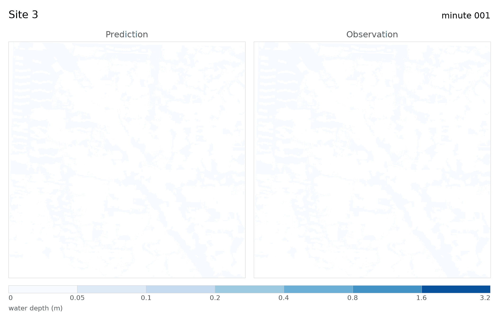

# DiT-Sparse · Urban Flood Forecasting Results

**English** | [简体中文](README.zh-CN.md)

This repository presents animated forecasting results from the DiT-Sparse project for urban flood inundation. At this stage it provides GIF animations only; the code is still being prepared and reviewed.

Each animation compares the model prediction (left) with the hydrodynamic simulation (right). Colours indicate water depth in metres, and areas outside the computational domain are shown in white.

## Datasets

| Dataset | Regions | Model | Test event | Duration |
| --- | --- | --- | --- | --- |
| Paper dataset | tjyz, wjl | CA-Sparse | 526wd | 120 min |
| Shenzhen dataset (U-RNN / UrbanFlood24) | Sites 1–3 | GF-Dense | r300y_p0.8_d3h | 360 min |

## 1. Paper dataset — tjyz and wjl

Both regions share the same 120-min rainfall event (526wd); the upper row shows tjyz and the lower row shows wjl.

| Region | MAE within mask (m) |
| --- | --- |
| tjyz | 0.0062 |
| wjl | 0.0115 |

- Depth classes: 0 / 0.15 / 0.3 / 0.5 / 1 / 3 / 5 m (depths above 5 m are capped at 5 m).
- 120 frames at 80 ms per frame.

## 2. Shenzhen dataset — data from U-RNN

The Shenzhen cases are drawn from the UrbanFlood24 dataset released with [U-RNN](https://github.com/holmescao/U-RNN), covering three sites (location1–3).

The test event is the 300-year design storm `r300y_p0.8_d3h` (peak factor 0.8, 3-hour hyetograph), with a total duration of 360 min; rainfall is concentrated in the first 180 min.

| Site | MAE within mask (m) | Peak prediction / observation (m) |
| --- | --- | --- |
| Site 1 | 0.0044 | 2.16 / 2.16 |
| Site 2 | 0.0035 | 2.98 / 2.96 |
| Site 3 | 0.0034 | 2.05 / 2.09 |

- Depth classes: 0 / 0.05 / 0.1 / 0.2 / 0.4 / 0.8 / 1.6 / 3.2 m.
- One frame every 3 min (121 frames at 70 ms per frame).

## Data and code

- Shenzhen dataset: UrbanFlood24 from U-RNN. Please comply with its license when reusing the data.
- More code and related information will be released after the review is completed.

## License

The images and text in this repository are licensed under [CC BY-NC 4.0](https://creativecommons.org/licenses/by-nc/4.0/) (see [LICENSE](LICENSE)) and are intended for non-commercial research and study only. You may copy, share and adapt the material with attribution for non-commercial purposes; commercial use is not permitted without permission.

For commercial licensing and collaboration, please contact **qimingcheng@foxmail.com**.
