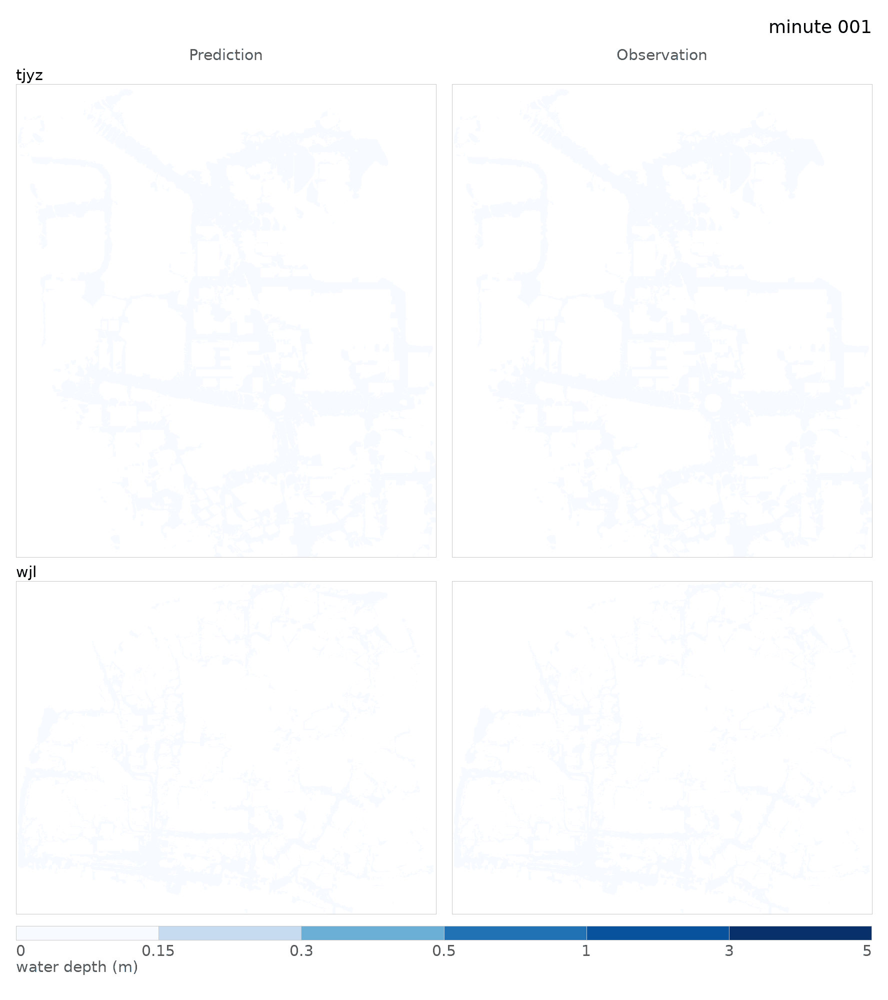
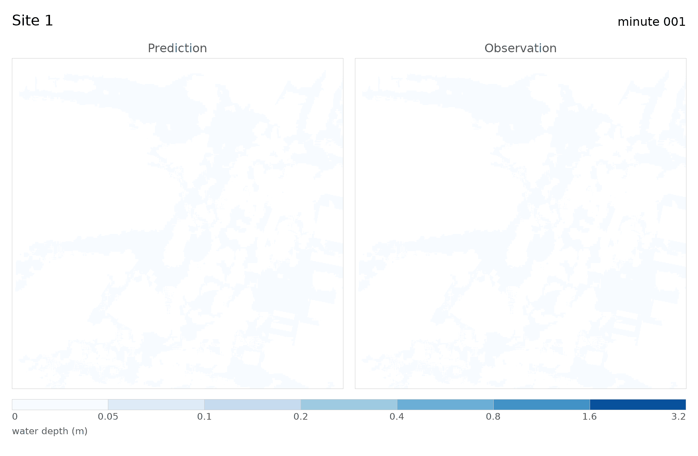
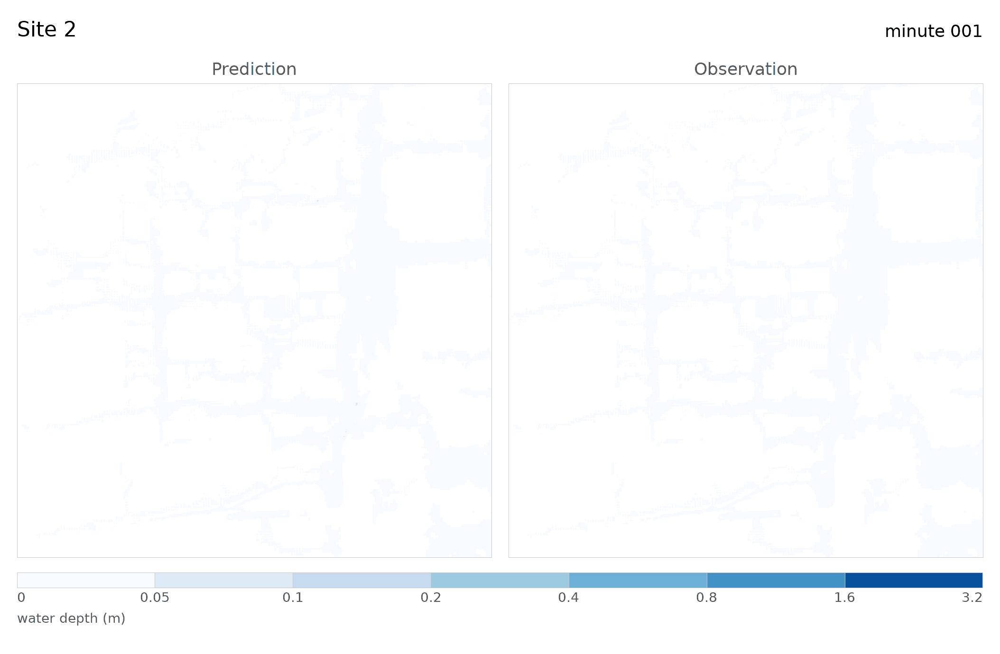

# DiT-Sparse · Urban Flood Forecasting Results

**English** | [简体中文](README.zh-CN.md)

Animated forecasts from the **DiT-Sparse** project for urban flood inundation (2-D hydrodynamic modelling). This repository currently hosts **GIF animations only** — the code is still being cleaned up and reviewed, and is not open-sourced yet.

Every animation shows **Prediction (left) vs. Observation (right)** from the hydrodynamic solver. Colours indicate water depth in metres; areas outside the computational mask are left white.

## Datasets at a glance

The animations come from two datasets:

| Dataset | Regions | Model | Test event | Duration |
| --- | --- | --- | --- | --- |
| Paper dataset | tjyz, wjl | CA-Sparse (epoch 200) | 526wd | 120 min |
| Shenzhen dataset (U-RNN / UrbanFlood24) | Sites 1–3 | GF-Dense (240-min window) | r300y_p0.8_d3h | 360 min |

## 1. Paper dataset — tjyz and wjl

The same rainfall event (526wd, 120 min) over two regions: top row tjyz, bottom row wjl.

| Region | MAE inside mask (m) |
| --- | --- |
| tjyz | 0.0062 |
| wjl | 0.0115 |

- Water-depth classes: 0 / 0.15 / 0.3 / 0.5 / 1 / 3 / 5 m (depths above 5 m are clipped to 5 m).
- 120 frames, 80 ms per frame, looping.

## 2. Shenzhen dataset — data from U-RNN

The Shenzhen cases come from the **UrbanFlood24** dataset released with [U-RNN](https://github.com/holmescao/U-RNN), covering three sites (location1–3).

GF-Dense is trained from scratch for 200 epochs on each site with a 240-min rainfall window (159 min history + 1 min current + 80 min future), and the epoch-200 weights are used here. The test event is the 300-year design storm `r300y_p0.8_d3h` (peak factor 0.8, 3-hour hyetograph), 360 min in total, with rainfall concentrated in the first 180 min.

| Site | MAE inside mask (m) | Peak prediction / observation (m) |
| --- | --- | --- |
| Site 1 | 0.0044 | 2.16 / 2.16 |
| Site 2 | 0.0035 | 2.98 / 2.96 |
| Site 3 | 0.0034 | 2.05 / 2.09 |

- Water-depth classes: 0 / 0.05 / 0.1 / 0.2 / 0.4 / 0.8 / 1.6 / 3.2 m.
- One frame every 3 min, 121 frames, 70 ms per frame, looping.

## Data and code availability

- Shenzhen dataset: UrbanFlood24 from [U-RNN](https://github.com/holmescao/U-RNN); please follow its license when reusing the data.
- Paper dataset, model weights, and the inference/rendering scripts are still under review and are not public yet.
- The GIFs in this repository were rendered with Pillow, stitching prediction and observation frames together.

## License

The images and text in this repository are released for **non-commercial research and study only**, under [CC BY-NC 4.0](https://creativecommons.org/licenses/by-nc/4.0/) (full text in [LICENSE](LICENSE)). You may copy, share and adapt them with attribution for non-commercial purposes; **commercial use is not permitted without permission**.

For commercial licensing or collaboration, please contact **qimingcheng@foxmail.com**.
