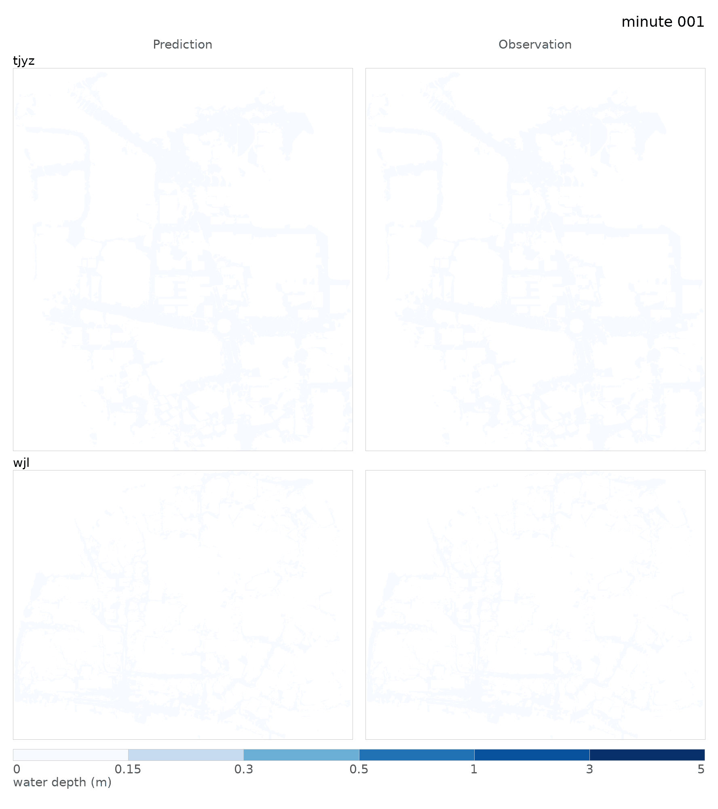
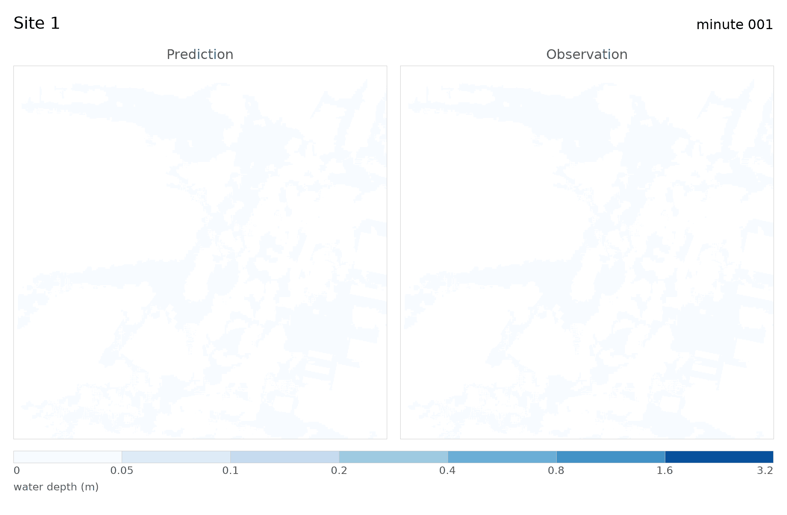
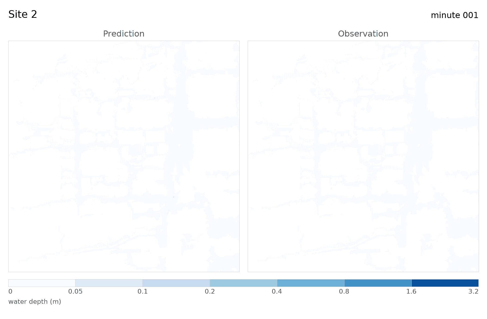
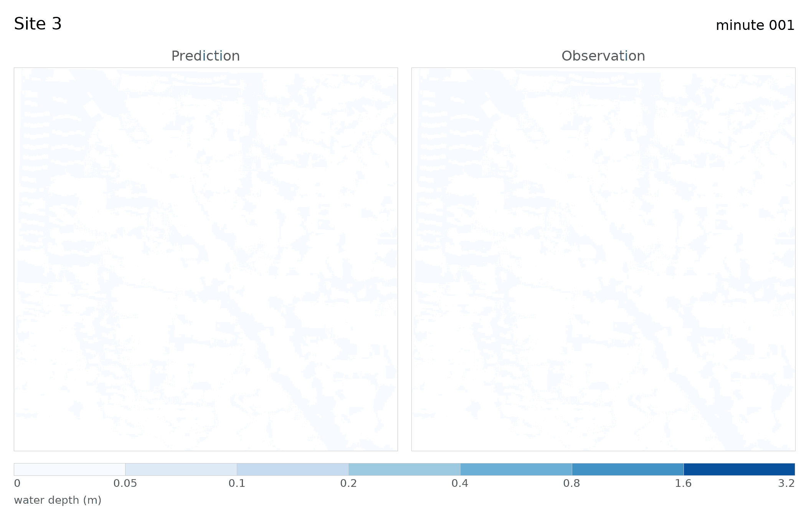

# DiT-Sparse · 城市内涝预报结果

[English](README.md) | **简体中文**

本仓库展示 DiT-Sparse 项目在城市内涝预报方面的动画结果，目前仅提供 GIF 动画，代码仍在整理与审核中。

每幅动画均为模型预报（左）与水动力模型模拟（右）的对比，颜色表示水深（m），计算域以外区域以白色显示。

## 数据集

| 数据集 | 区域 | 模型 | 测试事件 | 时长 |
| --- | --- | --- | --- | --- |
| 论文数据集 | tjyz、wjl | CA-Sparse | 526wd | 120 min |
| 深圳市数据集（U-RNN / UrbanFlood24） | Site 1–3 | GF-Dense | r300y_p0.8_d3h | 360 min |

## 1. 论文数据集：tjyz 与 wjl

两个区域共用同一场 120 分钟降雨事件（526wd），上排为 tjyz，下排为 wjl。

| 区域 | 掩膜内 MAE (m) |
| --- | --- |
| tjyz | 0.0062 |
| wjl | 0.0115 |

- 水深分级：0 / 0.15 / 0.3 / 0.5 / 1 / 3 / 5 m，超过 5 m 按 5 m 显示。
- 共 120 帧，每帧 80 ms。

## 2. 深圳市数据集（数据来源：U-RNN）

深圳算例取自 U-RNN 发布的 UrbanFlood24 数据集，涵盖三个场地（location1–3）。

测试事件为 300 年一遇设计暴雨 `r300y_p0.8_d3h`（峰值系数 0.8，3 小时雨型），总时长 360 分钟，降雨集中于前 180 分钟。

| 场地 | 掩膜内 MAE (m) | 峰值 预报 / 实测 (m) |
| --- | --- | --- |
| Site 1 | 0.0044 | 2.16 / 2.16 |
| Site 2 | 0.0035 | 2.98 / 2.96 |
| Site 3 | 0.0034 | 2.05 / 2.09 |

- 水深分级：0 / 0.05 / 0.1 / 0.2 / 0.4 / 0.8 / 1.6 / 3.2 m。
- 每 3 分钟一帧，共 121 帧，每帧 70 ms。

## 数据与代码

- 深圳市数据集：U-RNN 的 UrbanFlood24，使用数据时请遵循其许可要求。
- 更多代码及相关信息将在审核结束后发布。

## 访问说明

部分网络对 GitHub 图床（`raw.githubusercontent.com`）访问受限，若上方动画无法显示，可直接打开：

- [tjyz / wjl](https://ghfast.top/https://raw.githubusercontent.com/ManholeFixerXiaoming/DiT-Sparse/main/tjyz_wjl_demo/tjyz_wjl.gif)
- [Site 1](https://ghfast.top/https://raw.githubusercontent.com/ManholeFixerXiaoming/DiT-Sparse/main/shenzhen_gf_dense/site1_gf_dense.gif)、[Site 2](https://ghfast.top/https://raw.githubusercontent.com/ManholeFixerXiaoming/DiT-Sparse/main/shenzhen_gf_dense/site2_gf_dense.gif)、[Site 3](https://ghfast.top/https://raw.githubusercontent.com/ManholeFixerXiaoming/DiT-Sparse/main/shenzhen_gf_dense/site3_gf_dense.gif)

## 许可

本仓库的图片与文档采用 [CC BY-NC 4.0](https://creativecommons.org/licenses/by-nc/4.0/) 许可（全文见 [LICENSE](LICENSE)），仅限非商业的学习与研究用途：在署名且非商业的前提下，可复制、传播与改编；未经许可不得用于商业用途。

商用授权与合作请联系：**qimingcheng@foxmail.com**。
